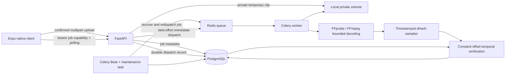

# Architecture

Current services implement a small controlled reference catalog, not source discovery
across the internet. Client uploads are never reference catalog entries. Operators ingest
rights-cleared media through a local CLI. The data model records provenance without claiming
that a supplied publisher is a verified creator or rights holder.

The API process and worker are separate in Compose. SQLite plus FastAPI BackgroundTasks
is an explicit development fallback. Retained artifacts: dependencies, database, catalog
fingerprints. Processes to restart: database, queue, API, worker and scheduler. No process-survival assumption.

Future boundaries: R2 StorageProvider replacing the volume; Supabase JWT authentication
and per-user RLS; audio/transcript/OCR/embedding evidence retrieval; pgvector candidate
search; isolated decoder containers. See providers.py for typed future model boundaries.
No provider silently returns invented evidence when unconfigured.

Account requests validate the configured Supabase issuer's public signing keys and bind
records in recognition_accounts. Direct client SQL access remains denied. Query object
storage now supports local files or an R2-compatible S3 backend; independent query_objects
records track failed deletion even after the parent history record is removed. Server
uploads remain bounded by the API; direct signed uploads and hosted activation are pending.
